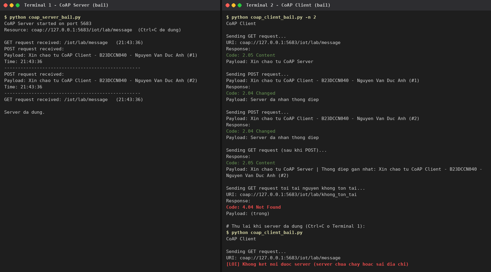
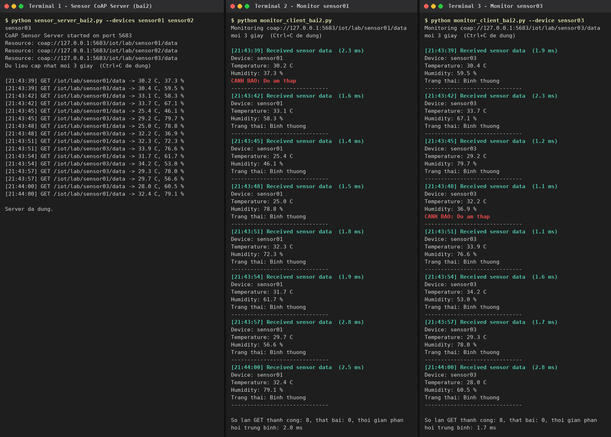
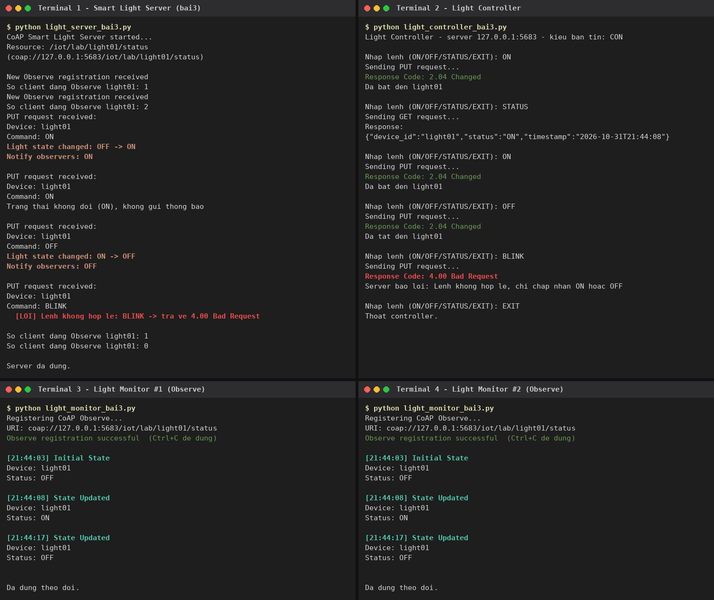

# Thực hành IoT – Buổi 3: Lập trình Python với giao thức CoAP

- **Sinh viên:** Nguyễn Văn Đức Anh
- **Mã sinh viên:** B23DCCN040
- **Hình thức:** làm cá nhân

## 1. Cấu trúc thư mục

```
CoAP_Lab/
|-- bai1/
|   |-- coap_server_bai1.py        # CoAP Server: GET / POST /iot/lab/message
|   |-- coap_client_bai1.py        # CoAP Client: gửi GET, POST
|-- bai2/
|   |-- sensor_server_bai2.py      # Server cảm biến, cập nhật dữ liệu mỗi 3 giây
|   |-- monitor_client_bai2.py     # Client GET định kỳ 3 giây, cảnh báo ngưỡng
|-- bai3/
|   |-- light_server_bai3.py       # Đèn thông minh: GET / PUT / Observe
|   |-- light_controller_bai3.py   # Nhập ON / OFF / STATUS / EXIT
|   |-- light_monitor_bai3.py      # Theo dõi trạng thái bằng CoAP Observe
|-- image/                         # Ảnh minh chứng (bai1.png, bai2.png, bai3.png)
|-- logs/                          # Log gốc của các lần chạy
|-- requirements.txt
|-- README.md
```

## 2. Môi trường

| Thành phần | Phiên bản |
|---|---|
| Python | 3.10 trở lên (yêu cầu của aiocoap 0.4.17; đã chạy thử với Python 3.13) |
| Thư viện | `aiocoap` 0.4.17 (code tương thích từ 0.4.7) |
| Giao thức | CoAP trên UDP, cổng mặc định **5683** |

Không cần MQTT Broker hay RabbitMQ: server và client CoAP đều tự viết bằng Python.

### Cài đặt

```bash
pip install -r requirements.txt      # hoặc: pip install aiocoap
```

## 3. Địa chỉ, cổng và URI tài nguyên

Mặc định server lắng nghe `127.0.0.1`, cổng UDP `5683`; client gửi tới `127.0.0.1`.

| Bài | URI | Phương thức |
|---|---|---|
| 1 | `coap://127.0.0.1:5683/iot/lab/message` | GET, POST |
| 2 | `coap://127.0.0.1:5683/iot/lab/sensor01/data` (thêm `sensor02`, `sensor03` khi mở rộng) | GET |
| 3 | `coap://127.0.0.1:5683/iot/lab/light01/status` (thêm `fan01`, `pump01` khi mở rộng) | GET, PUT, Observe |

`localhost` và `127.0.0.1` là cùng một máy. Code dùng `127.0.0.1` vì trên Windows `localhost` có thể được phân giải sang IPv6 (`::1`) trước.

**Chạy trên hai máy khác nhau:** chạy server với `--host 0.0.0.0`, client với `--server <IP máy chạy server>`, và cho phép UDP cổng 5683 qua tường lửa. Ví dụ:

```bash
python coap_server_bai1.py --host 0.0.0.0
python coap_client_bai1.py --server 192.168.1.10
```

## 4. Cách chạy từng chương trình

Mỗi chương trình chạy trong **một terminal riêng**, luôn chạy **server trước**. Nhấn `Ctrl+C` để dừng.

### Bài 1 – Gửi và nhận thông điệp CoAP cơ bản

```bash
cd bai1
# Terminal 1
python coap_server_bai1.py
# Terminal 2
python coap_client_bai1.py            # GET rồi POST 1 thông điệp
python coap_client_bai1.py -n 3       # (mở rộng) POST 3 thông điệp liên tiếp
```

Client lần lượt thực hiện:

1. GET `/iot/lab/message`, server trả `2.05 Content` với "Xin chao tu CoAP Server".
2. POST thông điệp "Xin chao tu CoAP Client - B23DCCN040 - Nguyen Van Duc Anh", server in nội dung và thời điểm nhận, trả `2.04 Changed`.
3. (Mở rộng) GET lại: server trả kèm thông điệp POST gần nhất.
4. (Mở rộng) GET tài nguyên không tồn tại, nhận `4.04 Not Found`.
5. (Mở rộng) Nếu server không chạy hoặc không phản hồi sau 5 giây, client báo lỗi thay vì treo.

### Bài 2 – Mô phỏng cảm biến nhiệt độ, độ ẩm

```bash
cd bai2
# Terminal 1
python sensor_server_bai2.py                                       # chỉ sensor01
python sensor_server_bai2.py --devices sensor01 sensor02 sensor03  # (mở rộng) 3 cảm biến
# Terminal 2
python monitor_client_bai2.py                          # giám sát sensor01
python monitor_client_bai2.py --device sensor03        # (mở rộng) chọn thiết bị
python monitor_client_bai2.py --csv sensor_log.csv     # (mở rộng) ghi dữ liệu ra CSV
```

- Server sinh dữ liệu ngẫu nhiên (nhiệt độ 24–38 °C, độ ẩm 35–85 %) và cập nhật mỗi 3 giây.
- GET trả JSON với Content-Format `application/json`:

  ```json
  {"device_id": "sensor01", "temperature": 28.5, "humidity": 65.2, "timestamp": "2026-10-31T21:43:39"}
  ```

- Client GET mỗi 3 giây và in mã thiết bị, nhiệt độ, độ ẩm, thời điểm nhận. Cảnh báo `CANH BAO: Nhiet do cao` khi nhiệt độ > 35, `CANH BAO: Do am thap` khi độ ẩm < 40, ngược lại in `Trang thai: Binh thuong`.
- Mở rộng: khi thoát, client in số lần GET thành công / thất bại và thời gian phản hồi trung bình. Nếu server không phản hồi, client báo lỗi rồi thử lại ở chu kỳ sau.

### Bài 3 – Đèn thông minh với CoAP Observe

```bash
cd bai3
# Terminal 1
python light_server_bai3.py                                  # light01, trạng thái ban đầu OFF
python light_server_bai3.py --devices light01 fan01 pump01   # (mở rộng) nhiều thiết bị
# Terminal 2 (có thể mở thêm Terminal 3 chạy lệnh này lần nữa để thử nhiều client Observe)
python light_monitor_bai3.py
# Terminal 3
python light_controller_bai3.py
python light_controller_bai3.py --non                        # (mở rộng) gửi bản tin Non-confirmable
```

Lệnh trong controller: `ON`, `OFF`, `STATUS`, `EXIT`. Có thể chỉ định thiết bị khác, ví dụ `fan01 ON`.

| Thao tác | Request | Kết quả |
|---|---|---|
| `ON` / `OFF` | PUT `{"device_id":"light01","command":"ON"}` | `2.04 Changed` |
| `STATUS` | GET | `2.05 Content`, `{"device_id":"light01","status":"ON",...}` |
| Lệnh sai (vd `BLINK`), JSON sai, sai `device_id` | PUT | `4.00 Bad Request` |

- Monitor gửi GET có option **Observe = 0** để đăng ký, nhận trạng thái ban đầu, sau đó **chỉ chờ server tự gửi thông báo** (`async for ... in request.observation`), không có vòng lặp GET định kỳ.
- Server dùng `aiocoap.resource.ObservableResource`. Khi trạng thái **thực sự thay đổi**, server gọi `updated_state()` để thông báo tới mọi client đang Observe. Gửi lại cùng trạng thái (ON khi đèn đang ON) thì trả `2.04` nhưng không gửi thông báo.
- Mở rộng: payload có `timestamp`; mỗi lần đổi trạng thái được ghi vào `bai3/light_log.txt`.

## 5. Kết quả đạt được

### Ảnh minh chứng

Ảnh được dựng trực tiếp từ log của các lần chạy thật (server và client trên cùng máy, `127.0.0.1:5683`, Python 3.13 + aiocoap 0.4.17). Log gốc nằm trong thư mục `logs/`.

**Bài 1 – CoAP Server / Client (GET, POST, 4.04, server tắt)**



**Bài 2 – Sensor Server và 2 Monitoring Client (sensor01, sensor03)**



**Bài 3 – Smart Light Server, Controller và 2 Monitor cùng Observe**



### Tóm tắt kết quả

**Bài 1**

```
Sending GET request...
URI: coap://127.0.0.1:5683/iot/lab/message
Response:
Code: 2.05 Content
Payload: Xin chao tu CoAP Server

Sending POST request...
Payload: Xin chao tu CoAP Client - B23DCCN040 - Nguyen Van Duc Anh (#1)
Response:
Code: 2.04 Changed
Payload: Server da nhan thong diep
```

- [x] Khởi tạo và chạy được CoAP Server trên cổng 5683
- [x] Client gửi thành công GET và POST, server xử lý đúng từng phương thức
- [x] Server in nội dung và thời điểm nhận POST, trả phản hồi xác nhận
- [x] Mở rộng: POST nhiều lần, GET trả thông điệp gần nhất, `4.04 Not Found`, báo lỗi khi server không chạy

**Bài 2**

```
[21:43:48] Received sensor data  (1.1 ms)
Device: sensor03
Temperature: 32.2 C
Humidity: 36.9 %
CANH BAO: Do am thap
------------------------------
[21:43:51] Received sensor data  (1.1 ms)
Device: sensor03
Temperature: 33.9 C
Humidity: 76.6 %
Trang thai: Binh thuong
```

- [x] Server cung cấp tài nguyên cảm biến qua URI, dữ liệu cập nhật mỗi 3 giây
- [x] Payload JSON, Content-Format `application/json`
- [x] Client GET định kỳ 3 giây, phân tích JSON, cảnh báo đúng ngưỡng
- [x] Mở rộng: `timestamp`, 3 cảm biến, chọn thiết bị, ghi CSV, đếm số lần GET và thời gian phản hồi trung bình, xử lý khi server không phản hồi

**Bài 3**

```
PUT request received:
Device: light01
Command: ON
Light state changed: OFF -> ON
Notify observers: ON
```

```
[21:44:03] Initial State
Device: light01
Status: OFF

[21:44:08] State Updated
Device: light01
Status: ON
```

- [x] Server quản lý tài nguyên `light01`, hỗ trợ GET, PUT và Observe
- [x] Controller gửi PUT (ON/OFF), GET (STATUS), nhận đúng mã phản hồi
- [x] Monitor đăng ký Observe thành công, tự nhận thông báo khi trạng thái đổi (không polling)
- [x] Hai monitor cùng Observe đều nhận thông báo
- [x] Mở rộng: lệnh sai trả `4.00 Bad Request`, nhiều thiết bị, `timestamp`, ghi log ra file, chọn CON/NON

## 6. Lưu ý / xử lý lỗi

- `ModuleNotFoundError: No module named 'aiocoap'`: chạy `pip install aiocoap`.
- `Address already in use` / `OSError` khi chạy server: đang có server khác chiếm cổng 5683. Dừng server cũ (Ctrl+C) hoặc chạy với `--port 5684` (client cũng phải dùng `--port 5684`).
- Windows có thể hỏi cho phép Python qua tường lửa ở lần đầu chạy server: chọn **Allow**.
- Mỗi bài dùng chung cổng 5683, nên chỉ chạy server của **một bài** tại một thời điểm.
